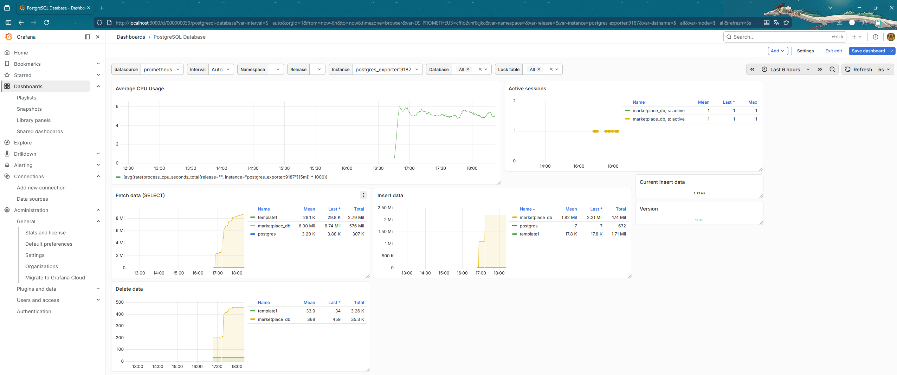

# PostgreSQL Internals, DB-Based Message Broker & Data Engineering

Инженерный репозиторий по архитектуре данных и внутреннему устройству СУБД: от реляционного моделирования и разработки брокера задач на **Spring Boot** поверх PostgreSQL до профилирования индексов под мониторингом Grafana, настройки репликации, ETL-пайплайнов **Airflow → ClickHouse** и стендов с NoSQL-движками.

---

## 🗂 Структура проекта и ключевые модули

### 1. Spring Boot Message Broker поверх PostgreSQL (`/message-broker`, `/s2/queue`)
Сервис на Java и Spring Boot для асинхронной обработки заказов (`Order`) через таблицу очереди задач (`Task`, миграция `V5__create_tasks_queue_table.sql`):
* **Компоненты:** `ProducerService` (создание заказов и постановка задач), `WorkerService` (обработка задач из очереди), `MonitorService` (мониторинг состояния очереди).
* 📄 **[Документация по архитектуре очереди](./s2/queue/QUEUE.md)**

### 2. PostgreSQL Internals, Оптимизация и High Availability (`/s2`)
Практические исследования и замеры производительности СУБД со сбором кастомных метрик (`queries.yml`) в **Prometheus** и визуализацией в **Grafana**:
* **Индексы и планы выполнения (`EXPLAIN ANALYZE`):**
  * [Анализ планов запросов и B-Tree индексов](./s2/explain_index/explain_index_result.md)
  * [Профилирование GIN и GiST индексов](./s2/gin-gist-grafana/gin_gist_results.md)
  * [Сравнение алгоритмов JOIN](./s2/gin-gist-grafana/joins_results.md)
* **Хранение данных и транзакционный движок:**
  * [Исследование MVCC и версионности строк](./s2/mvcc_results.md)
  * [Анализ журнала предзаписи (WAL)](./s2/wal/wal.md)
  * [Секционирование (Partitioning) таблиц](./s2/partition_hw/partition_hw.md)
* **Отказоустойчивость:**
  * [Настройка репликации PostgreSQL (Primary–Standby)](./s2/replication_hw/replication.md) (скрипты инициализации — в [`primary_init/`](./primary_init)).



### 3. Data Engineering: Apache Airflow & ClickHouse DWH (`/s2/airflow`, `/s2/olap`)
Построение аналитического хранилища (OLAP) и автоматизированных ETL-пайплайнов из PostgreSQL в **ClickHouse**:
* **[OLAP-схема и аналитические запросы](./s2/olap/olap.md):** DDL-схема (`01_ddl_olap_schema.sql`), загрузка данных (`02_etl_data_load.sql`) и аналитические выборки (`03_analytical_queries.sql`).
* **[Оркестрация в Apache Airflow](./s2/airflow/отчет.md):**
  * `01_etl_postgres.py` — загрузка и обработка данных из CSV (`new_pvz.csv`) в PostgreSQL.
  * `02_analytics_postgres_to_ch.py` — регулярная выгрузка аналитики из PostgreSQL в витрины **ClickHouse** (`init_dwh.sql`).

### 4. Polyglot Persistence & NoSQL стенды (`/s2/homeworks_from_classmates`)
Практические Docker Compose стенды и разборы кейсов использования профильных СУБД:
* **Columnar OLAP:** [ClickHouse](./s2/homeworks_from_classmates/clickhouse/hw.md)
* **Wide-Column:** [Apache Cassandra](./s2/homeworks_from_classmates/cassandra/hw.md)
* **Vector DB:** [Qdrant](./s2/homeworks_from_classmates/qdrant/hw.md)
* **Graph DB:** [Neo4j](./s2/homeworks_from_classmates/neo4j/hw.md)
* **Time-Series:** [InfluxDB](./s2/homeworks_from_classmates/influxdb/hw.md)
* **Search & Document:** [Elasticsearch](./s2/homeworks_from_classmates/elasticsearch/hw.md) | [MongoDB](./s2/homeworks_from_classmates/mongodb/hw.md)
* **In-Memory:** [Redis / Valkey](./s2/homeworks_from_classmates/redis_valkey/hw.md)

### 5. Реляционное моделирование и продвинутый SQL (`/s1`)
Проектирование БД маркетплейса, нормализация и практические запросы в PostgreSQL:
* [Описание схемы и ER-диаграммы](./s1/README.md)
* [Оконные функции, CTE и UNION](./s1/cte_union_window.md)
* [Агрегации и группировки](./s1/aggregate_group_queries.md) | [JOIN](./s1/select_join_queries.md) | [Подзапросы](./s1/sub_queries.md)
* [Функции и хранимые процедуры](./s1/fn_proc.md) | [Триггеры и pg_cron](./s1/trigger_cron.md)
* [Транзакции и уровни изоляции](./s1/transactions.md)

---

## 🚀 Быстрый запуск

### 1. Инфраструктура PostgreSQL, миграции Flyway и мониторинг
```bash
docker compose up -d
docker compose run flyway
```

### 2. Spring Boot брокер задач (`message-broker`)

```bash
cd message-broker
./mvnw spring-boot:run
```

### 3. Стенд Apache Airflow + ClickHouse

```bash
cd s2/airflow
docker compose up -d
```